<h1 class="text-5xl font-black">Nais as a Service</h1>

Gir fart og flyt på utviklingen av Norge

Hans Kristian Flaatten · Nais-teamet i Nav

<!--
Overgang: «Hei, jeg heter Hans Kristian og jobber i Nais-teamet i Nav.»

- Målgruppe: teknologiledere, arkitekter og beslutningstakere
- Tesen: Plattformen Nav bygde for seg selv er nå en tjeneste for det offentlige
- Ingen demo i dag, bare animasjoner
-->

---
layout: default
clicks: 2
---

::header::
<h1 class="text-3xl font-bold">Problemet</h1>

Hver etat bygger sin egen plattform

::default::
<ProblemStacks />

<!--
Overgang: «Og den felles plattformen er ikke en idé. Den har vokst siden 2016. Se.»

- Hver etat som bygger egen plattform, trenger knapp og dyr kompetanse
- Klikk 1: det som ofte blir resultatet. Eksempel: en Azure landing zone og en wiki. Utviklerne mangler resten
- Få lykkes. Det krever ressurser og vilje over år. Plattform er et produkt, ikke et prosjekt
- Klikk 2: én felles plattform. ≈ 150 årsverk er Nav sitt eget anslag
-->

---
layout: none
transition: fade
---

<ClipSlide />

<!--
Overgang: «(Ingen overgang. La klippet gå, ikke snakk over det.)»

- 6 tenants, 5 212 apper (Grafana, 21. oktober 2026). KS Digital og Novari har signert, men har ikke apper i produksjon ennå
- ≈21 500 deployer per uke er Nav, alle miljøer (Mimir)
- Fargene viser de mindre tenantene spredt i bikuben
-->

---
layout: default
transition: fade
---

::header::
<h1 class="text-3xl font-bold">Hva er Nais</h1>

En plattform laget av Nav for å gi fart og flyt til utviklerne av det offentlige Norge

::default::
<NaisPillars />

Vi mener at det skal være lett å gjøre rett.

<!--
Overgang: «Seks ting Nais skal gi dere. Jeg kommer tilbake til dem underveis. Først: brukes dette faktisk?»

- Teksten og søylene er hentet fra nais.io
- Vi mener at det skal være lett å gjøre rett
- Hjørnemerket på senere slides viser hvilken søyle de handler om
-->

---
layout: default
---

::header::
<h1 class="text-3xl font-bold">Tre tenants utenfor Nav kjører 528 apper</h1>

Og Nav deployer rundt 21 500 ganger i uka

::default::

  

    <CountUp number="6" label="Tenants" />
    <CountUp number="5212" label="Apper, alle tenants" :delay="0.08" />
    <CountUp number="21500" prefix="≈" label="Deployer per uke (Nav)" :delay="0.16" />
    <CountUp number="154" label="Team som har deployet siste 28 dager (Nav)" :delay="0.24" />
  

  
En tenant er en virksomhet som bruker Nais.

  <YearChart metric="deploys" />
  

    
    
    
    
    
    
  

<!--
Overgang: «Grunnen til at tallene er så store, kommer på neste slides.»

- Apper per tenant: Grafana 21. oktober 2026 (72 + 164 + 292 = 528 utenfor Nav)
- ≈21 500 deployer per uke i Nav, alle miljøer. ≈9 000 i prod (Mimir)
- 154 team har deployet siste 28 dager
- Reserve: ukegrafen fra Mimir (11 uker, aug.–okt. 2026) ligger i DeployChart hvis noen spør
- PLASSHOLDER: årstall for veksten fra Nais-teamet
-->

---
layout: default
clicks: 5
---

::header::
<h1 class="text-3xl font-bold">Hva Nais har betydd for Nav</h1>

::default::
<BenefitStory :items="[
  { icon: 'i-carbon-building', title: 'Fundament', description: 'Autonome team' },
  { icon: 'i-carbon-rocket', title: 'Fart og flyt', description: 'Kortere vei til prod' },
  { icon: 'i-carbon-user-speaker', title: 'Utviklere', description: 'Fornøyde' },
  { icon: 'i-carbon-group', title: 'Ansatte', description: 'Fornøyde' },
  { icon: 'i-carbon-face-satisfied', title: 'Brukere', description: 'Fornøyde' },
]" />

  <Placeholder class="anim-item">DORA for Nav: deployfrekvens</Placeholder>
  <Placeholder class="anim-item">DORA for Nav: ledetid for endringer</Placeholder>

<!--
Overgang: «Og det har en bieffekt: utviklerne tar Nais med seg.»

- Ett klikk per steg, konfetti til slutt
- PLASSHOLDER: DORA-tall for Nav (deployfrekvens og ledetid)
-->

---
layout: default
clicks: 3
---

::header::

 Et Nais-fellesskap

<h1 class="text-3xl font-bold">Utviklerne kan det allerede</h1>

::default::
<DevFlow />

<!--
Overgang: «Grunnen til at 154 team deployer 21 500 ganger i uka, er at dette er alt de må skrive.»

- Anslag: ~800 utviklere i Nav i dag; antatt ~40 % konsulenter med ~3 års oppdrag (~100 nye i året) og ~8 % turnover blant ansatte (~40 nye i året); ~9 år i produksjon → ~1 300 som har gått videre + ~800 i dag ≈ 2 000. Utviklere hos de andre tenantene er ikke med
- Rekruttering blir enklere, og opplæringen kortere
- Konsulenter kjenner plattformen, og utviklere etterspør den
- PLASSHOLDER: antall konsulentselskaper med Nais-erfaring, og et sitat fra en utvikler eller konsulent
-->
---
layout: default
clicks: 7
---

::header::

 Utviklingsfart

<h1 class="text-3xl font-bold">Ett manifest, ferdig oppsett</h1>

Ingen Terraform, ingen egen infrastruktur

::default::
<ManifestDeep />

<!--
Overgang: «Så skal vi se hva som skjer når de trykker på knappen.»

- Feltnavn fra Application-eksempelet i nais/doc
- Hvert klikk skriver én blokk, og ressursen dukker opp rundt appen
- Ingen Terraform, ingen egen infrastruktur
-->

---
layout: default
clicks: 4
---

::default::

 Utviklingsfart

<DeployFlow />

<!--
Overgang: «Men hva skjer egentlig på plattformsiden?»

- Bygg i GitHub Actions, deploy med Nais, pods i Kubernetes, live
- Ett klikk per steg
-->

---
layout: default
transition: view-transition
clicks: 1
---

::header::

 Automatisering

<h1 class="text-3xl font-bold">Hva skjer på plattformsiden</h1>

Naiserator gjør manifestet om til ressurser

::default::
<AppFanout />

<!--
Overgang: «Det var én app. Zoom ut, og her er hele hylla.»

- Naiserator lager Kubernetes-ressursene: Deployment, Service, Ingress, NetworkPolicy og flere
- Operatorer tar over resten: Config Connector, aivenator, azurerator, digdirator, jwker
-->

---
layout: default
clicks: 8
---

::header::

 Automatisering

<h1 class="text-3xl font-bold">Verktøykassa</h1>

Alt rundt appen, klart til bruk

::default::
<Toolbox mode="open" />

<!--
Overgang: «Jeg åpner to skuffer. Først: hva skjer når noe feiler?»

- Én skuff per klikk, til slutt alt på en gang
- Gruppert etter inventaret over verktøykassa. Utfasede ting er utelatt
- MCP for kodeagenter ligger i Verktøy-skuffen
-->

---
layout: default
---

::header::

 Oversikt

<h1 class="text-3xl font-bold">Slik flyter signalene</h1>

Logger uten oppsett, metrikker og traces med én linje i manifestet

::default::
<ObsFlow />

<!--
Overgang: «Så la oss jakte på en feil.»

- Kilde: docs.nais.io, «How Nais APM works»
- Logger: stdout via Fluent Bit til Loki, uten oppsett. Traces og metrikker: OpenTelemetry Collector til Tempo og Mimir. Metrikker hentes også fra appens metrics-endepunkt via PodMonitor
- Alt vises i Grafana. Skrus på med observability.autoInstrumentation
-->

---
layout: default
clicks: 4
---

::header::

 Oversikt

<h1 class="text-3xl font-bold">Jakten på feilen</h1>

Fra feil til fiks: signalene henger sammen fra start

::default::
<BugHunt />

<!--
Overgang: «Og alt dette ser teamet også i Console.»

- Illustrasjon, ikke ekte tall
- Varsel, trace, logger for samme trace, fiks
- Signalene henger sammen fra start
-->

---
layout: default
clicks: 1
---

::header::

 Oversikt

<h1 class="text-xl font-bold">Console: teamets oversikt</h1>

::default::
<ConsoleMock story="team" />

<!--
Overgang: «Og hver app kan teamet se for seg.»

- Illustrasjon bygd etter Console sin struktur, ingen ekte data
- Team health, inventar og siste aktivitet
- Klikk: kostnad per tjeneste
-->

---
layout: default
clicks: 1
---

::header::

 Oversikt

<h1 class="text-xl font-bold">Console: én app</h1>

::default::
<ConsoleMock story="app" />

<!--
Overgang: «Og for de som liker terminalen:»

- Klikk: teamet åpner én app
- Helse, siste deploy, persistens og kostnad for akkurat den appen
-->

---
layout: default
clicks: 5
---

::header::

 Oversikt

<h1 class="text-2xl font-bold">Og fra terminalen</h1>

::default::
<CliDemo />

<!--
Overgang: «Det var utviklerens side. Nå snur vi bildet: alt som måtte stå for at dagen ble kjedelig.»

- Kommandoene finnes i Nais CLI (binæren heter nais, sjekket mot nais -h). Utdata er illustrasjon
- nais login, app status, app log, cloudsql proxy, vulnerability summary
-->

---
layout: default
clicks: 2
---

::header::
<h1 class="text-3xl font-bold">Hva dere slipper å drifte</h1>

Dere bruker verktøyene. Vi drifter alt under.

::default::
<Toolbox mode="ops" />

<!--
Overgang: «Og når noe likevel skjer om natta?»

- Samme verktøykasse, dempet
- Klikk 1: driften Nais tar. Klikk 2: streken mellom tenantens del og Nais' del
-->

---
layout: default
clicks: 3
---

::header::
<h1 class="text-3xl font-bold">Kl. 03.00</h1>

Samme varsel, samme Grafana. Forskjellen er hvem sin telefon som ringer.

::default::

  <FlowChain :nodes="[
    { icon: 'i-carbon-notification', label: 'Varsel', sub: 'Noe feiler kl. 03.00' },
    { icon: 'i-carbon-phone', label: 'Nais-vakt', sub: 'Vakthavende i Nais-teamet varsles' },
    { icon: 'i-carbon-cloud', label: 'Google', sub: 'Googles døgnåpne support ved behov' },
    { icon: 'i-carbon-checkmark', label: 'Løst', sub: 'Dere sov gjennom det' },
  ]" />
  

    <Placeholder class="anim-item">en ekte natt i fire steg: varsel, trace, logger, fiks (hva skjedde og hvor lang tid det tok)</Placeholder>
    

      
99,88 %

      
ingress-svar uten 5xx i Nav, siste 30 dager

      
Målt, ikke SLA

    

  

<!--
Overgang: «Hvem var våkne? Disse femten.»

- Vakt døgnet rundt er inkludert i NaaS: Nais-teamet, med Googles døgnåpne support ved behov. Google-supporten er inkludert i prisen
- 99,88 % er målt i Mimir, Nav, siste 30 dager. Tallet inkluderer feil i appene selv. Ingen formell SLA
- PLASSHOLDER: en ekte natt i fire steg
-->

---
layout: default
---

::header::
<h1 class="text-3xl font-bold">Nais-teamet</h1>

15 personer i Nav. Drifter for seks tenants.

::default::
<TeamWall />

<!--
Overgang: «Teamet bygger også sikkerheten inn i hver leveranse.»

- Hele teamet: femten personer, alle ansatt i Nav, som drifter for seks tenants
- Navn fra GitHub-teamet nais/nais
-->

---
layout: default
clicks: 4
---

::header::

 Sikkerhet

<h1 class="text-3xl font-bold">Sikkerhet i forsyningskjeden</h1>

::default::
<FlowChain :nodes="[
  { icon: 'i-carbon-build-tool', label: 'Bygg', sub: 'All kode, også fra KI-agenter' },
  { icon: 'i-carbon-list-boxes', label: 'SBOM', sub: 'Lages automatisk (CycloneDX)' },
  { icon: 'i-carbon-certificate', label: 'Signering', sub: 'Signert og attestert' },
  { icon: 'i-carbon-scan', label: 'Sårbarheter', sub: 'Følges opp per workload', stat: '5 608 workloads skannes (apper og jobber)' },
  { icon: 'i-carbon-dashboard', label: 'Console', sub: 'Teamet ser status' },
]" />

<!--
Overgang: «Og teamet ser resultatet i Console.»

- SBOM og signering skjer automatisk i bygget
- Kode fra KI-agenter går gjennom akkurat samme løp
- 5 608 workloads skannes (Mimir, 21. oktober 2026)
-->

---
layout: default
clicks: 4
---

::header::

 Sikkerhet

<h1 class="text-xl font-bold">Console: sårbarheter</h1>

::default::
<ConsoleMock story="vulns" />

<!--
Overgang: «Så langt har jeg snakket til utviklerne. Nå til dere som skal signere.»

- Illustrasjon, ikke ekte data eller CVE-er. «Fra varsel til lukket uten å forlate verktøyene» er en illustrasjon, ikke et løfte om tid
- Klikk 1: funnet åpnes (kjent utnyttet, rettelse finnes). Klikk 2: PR som oppdaterer avhengigheten
- Klikk 3: bygg med SBOM og signering, ny deploy. Klikk 4: nytt bilde skannes, og funnet er løst
-->

---
layout: default
clicks: 1
---

::header::

 Suveren og autonom

<h1 class="text-3xl font-bold">Hva kjører hvor</h1>

Dette er avhengighetene

::default::
<HostingMap />

<!--
Overgang: «Og hvis dere vil flytte, er det deres valg.»

- Google Cloud: GKE, Cloud SQL, buckets, BigQuery. Aiven: Kafka, OpenSearch, Valkey
- Nais drifter observability-stakken selv
- PLASSHOLDER: hvor dataene ligger (Google Cloud-region)
- Nais startet i eget datasenter i 2016 og flyttet til Google Cloud
-->

---
layout: default
clicks: 3
---

::header::

 Suveren og autonom

<h1 class="text-3xl font-bold">Deres data, deres exit</h1>

::default::
<TenantMap :tenants="['Nav', 'SSB', 'Landbruksdirektoratet', 'Arbeidstilsynet', 'KS Digital', 'Novari']" :incoming="['KS Digital', 'Novari']" :detach="3" exit-text="Exit-planen er dokumentert. Ingen har trengt den." />

<!--
Overgang: «Hvem bestemmer så hva som skjer med plattformen?»

- Hver tenant eier sin egen GCP-organisasjon. Nav eier faktureringskontoen
- Klikk 2: en tenant kobler seg fra, og alt blir med
- Exit-planen er dokumentert. Ingen har trengt den
-->

---
layout: default
---

::header::
<h1 class="text-3xl font-bold">Hvem bestemmer</h1>

Nais-teamet bestemmer veikartet, tenantene gir innspill på Naisdag

::default::
<GovernanceLoop />

<!--
Overgang: «Når vi sier ja til én tenant, sier vi ja til alle.»

- Nais-teamet bestemmer veikartet
- Tenantene gir innspill på Naisdag
- 1–2 nye tenants per år
-->

---
layout: default
clicks: 2
---

::header::

 Et Nais-fellesskap

<h1 class="text-3xl font-bold">Bedre sammen</h1>

Det én tenant trenger, får alle

::default::
<ShareLoop :agencies="['Nav', 'SSB', 'Landbruksdirektoratet', 'Arbeidstilsynet', 'KS Digital', 'Novari']" caption="Forbedringer kommer alle tenantene til gode" />
<Placeholder class="anim-item max-w-3xl mx-auto mt-12">sitat fra en tenant om NaaS (navn, rolle, virksomhet)</Placeholder>

<!--
Overgang: «Og dere står ikke alene.»

- Forbedringer for én tenant kommer alle til gode
- PLASSHOLDER: konkret eksempel og sitat fra en tenant
-->

---
layout: default
---

::header::

 Et Nais-fellesskap

<h1 class="text-3xl font-bold">Støtte og fellesskap</h1>

Dere er ikke alene

::default::
<HubSpokes center="Hjelp" center-icon="i-carbon-help" :start="-90" :spokes="[
  { icon: 'i-carbon-logo-slack', title: 'Slack', text: 'Direkte kontakt med Nais-teamet' },
  { icon: 'i-carbon-document', title: 'docs.nais.io', text: 'Dokumentasjon og veiledninger' },
  { icon: 'i-carbon-badge', title: 'Champions', text: 'Champions i teamene' },
  { icon: 'i-carbon-education', title: 'Arbeidsøkter', text: 'Praktiske økter med Nais-teamet' },
  { icon: 'i-carbon-group', title: 'Naisdag', text: 'Tenantene møtes og gir innspill' },
]" />

<!--
Overgang: «Alt dette er inkludert i én pris. Og den er selvkost.»

- Slack, docs.nais.io, champions i teamene, workshops og Naisdag
-->

---
layout: default
---

::header::
<h1 class="text-3xl font-bold">Hva koster det</h1>

Selvkost, uten påslag

::default::

  <Meter :parts="[
    { label: 'Management-cluster', value: 20000 },
    { label: 'App-cluster, dev', value: 10000 },
    { label: 'App-cluster, prod', value: 10000 },
  ]" />
  
≈ 150 årsverk bygget. Dere betaler selvkost for drift.

  
I tillegg kommer forbruket i Google Cloud og Aiven, også til selvkost. Kostnaden per team og app ser dere i Console.

<!--
Overgang: «150 årsverk, og 15 personer som holder det i gang. Hvem kan så bli med?»

- Management 20 000 + to app-clustere (typisk dev og prod) à 10 000 = 40 000 kr/mnd før forbruk
- PLASSHOLDER: hvordan tenantene faktureres (Nav eier faktureringskontoen, selvkost)
- Forbruk i Google Cloud og Aiven kommer i tillegg, til selvkost
-->

---
layout: default
---

::header::
<h1 class="text-3xl font-bold">Hvem kan bli med</h1>

Statlige virksomheter i egenregi

::default::

  
 Departementer

  
 Direktorater

  
 Etater og tilsyn

  
 Forvaltningsbedrifter

  
 Forvaltningsorganer med særskilte fullmakter

  
 Statlige ombud

NaaS passer ikke for skjermingsverdig informasjon eller systemer som må kjøre i eget datasenter.

<!--
Overgang: «Slik kommer dere i gang.»

- Egenregi i staten: kommuner, statsforetak og private kan ikke bruke NaaS
- Ikke for skjermingsverdig informasjon eller systemer som må kjøre i eget datasenter
-->

---
layout: default
clicks: 4
---

::header::
<h1 class="text-3xl font-bold">Veien inn</h1>

::default::
<JourneyPath :burst="false" :items="[
  { icon: 'i-carbon-presentation-file', title: 'Demo', description: 'Varighet: PLASSHOLDER', placeholder: true },
  { icon: 'i-carbon-chemistry', title: 'Pilot', description: 'Varighet: PLASSHOLDER', placeholder: true },
  { icon: 'i-carbon-migrate', title: 'Migrering', description: 'Varighet: PLASSHOLDER', placeholder: true },
  { icon: 'i-carbon-checkmark-outline', title: 'Drift', description: 'Dere utvikler, vi drifter' },
]" />
<Placeholder class="anim-item max-w-xl mx-auto">fra avtale til første app i prod (onboarding-tid)</Placeholder>

<!--
Overgang: «Og hvis det ikke passer: dere kan gå når som helst, med alt.»

- Demo, pilot, migrering, drift
- PLASSHOLDER: varighet per steg og tid fra avtale til første app i prod
-->

---
layout: cta
---

::header::
<h1 class="text-3xl font-bold">Dere kan gå når som helst, med alt</h1>

Utviklerne får fart fra dag én, tenanten beholder eierskapet og kan gå når som helst, og prisen er selvkost.

::default::

  

  

    
Snakk med oss om Nais passer for dere

    
<a href="mailto:nais@nav.no" class="text-accent font-bold">nais@nav.no</a> · <a href="https://nais.io" class="text-accent">nais.io</a>

  

<!--
Overgang: «Takk.»

- Koble tilbake til exit-sliden: tenanten eier alt
- QR-koden åpner e-post til nais@nav.no (som «Kontakt oss» på nais.io)
-->
