::logo::
<CoverLogo />

::default::
<h1 class="text-5xl font-black">Slipp utviklerne fri</h1>

Slik skapte vi ekstrem fart og flyt i Nav. Lett å gjøre rett.

Hans Kristian Flaatten · Nais-teamet i Nav

<!--
Overgang: «Først: hvem står her?»

- Hei, jeg heter Hans Kristian og jobber i Nais-teamet i Nav
- Tesen: lett å gjøre rett. Den kommer tilbake på slutten
- Publikum er blandet: ledere og utviklere. Ingen demo, bare animasjoner
-->

---
layout: default
---

::header::
<h1 class="text-3xl font-bold">Hvem er jeg</h1>

Hans Kristian Flaatten, Nais-teamet i Nav

::default::

  

    <HexagonImage :src="avatar" alt="Hans Kristian Flaatten" size="8rem" />
    <ul>
      <li> Bygger og drifter Nais</li>
      <li> Innførte OpenTelemetry i Nav</li>
      <li> Foredrag, konferanser og podcaster</li>
      <li> Kontakt for Nais as a Service</li>
      <li> Leder KI-satsingen i Nav</li>
    </ul>
  

  

    <b>Utenfor jobb</b>
    

<b>Varden</b>
KI-assistent for familien i iMessage: morgenmelding, ukeplan og barneradioen Morgenrådet.

    

<b>NisseKomm</b>
Adventskalender-app til barna, med video, radio og spill.

  

<!--
Overgang: «Litt mer om Varden, for den sier noe om hvordan jeg tenker.»

- Jobber i Nais-teamet i Nav. Innførte OpenTelemetry i Nav, snakker om Nais på konferanser og i podcaster, er kontakt for Nais as a Service og leder KI-satsingen i Nav
- Utenfor jobb: Varden (varden.flaatten.org), en KI-assistent familien snakker med i iMessage. Bygd på OpenClaw og Gemini, kjører på en Mac mini og et Kubernetes-cluster hjemme
- NisseKomm: adventskalender-app jeg har laget til barna. Ikke vis innhold, figurer eller historie
- Ikke nevn barnas navn, alder, skole eller klubber
- TODO: skjermbilde av NisseKomm når Hans har godkjent det i NisseKomm-sesjonen
-->

---
layout: default
clicks: 5
---

::header::
<h1 class="text-3xl font-bold">Varden (utenom jobb)</h1>

En KI-assistent som bor i familiens gruppechat

::default::
<VardenDay />

  Mac mini · Kubernetes hjemme · MCP · varden.flaatten.org
  «Access control before intelligence.»

<!--
Overgang: «Jeg starter med et tall.»

- 05:30: huset sover, Varden lager dagens Morgenrådet
- 06:15: morgenmelding i familiechatten med vær, dagsplan og pakkeliste
- 15:00: varsel til foreldrene når treningen flyttes
- 17:00: skjermtid etter reglene foreldrene har satt, med pause mellom øktene
- 20:00: påminnelse om det som trengs i morgen
- 23:00: Varden skriver ned dagens hendelser og avgjørelser
- Varden er oppkalt etter varden, steinrøysa som viser vei i tåka. Den bor i familiens gruppechat i iMessage (varden.flaatten.org/about)
- Morgenrådet: radioepisode på 4–7 minutter, laget hver morgen. Første episode var 171 sekunder (varden.flaatten.org/how-i-learned-to-talk)
- Mac-hjelp: osquery på barnas Mac-er, spørsmål med SQL, uten skjermbilder eller tastelogg (varden.flaatten.org/endpoint-observability)
- Teknologi: Mac mini M4, Kubernetes-cluster hjemme med MCP-servere på Knative, Go-tjeneste for radio (varden.flaatten.org/hello-world)
- «Access control before intelligence»: tilgang først, så intelligens. Samme tanke som i Nais: sikkerheten ligger i veien
- Tallene er fra Varden-bloggen, ikke uavhengig sjekket. Ikke nevn barnas navn, alder, skole eller klubber
-->

---
layout: default
---

::header::
<h1 class="text-3xl font-bold">≈ 9 000 ganger i uka</h1>

Så ofte setter teamene i Nav noe i produksjon

::default::

  <CountUp number="9000" prefix="≈" label="prodsettinger per uke" />
  
<StatHighlight number="150" label="utviklingsteam (anslag)" />

<!--
Overgang: «Slik var det ikke alltid.»

- ≈ 9 000 prodsettinger per uke i Nav, bare produksjon (Mimir, oktober 2026)
- Eneste gang tallet teller opp. Det kommer tilbake på slide 17
- 150 utviklingsteam er et anslag. 154 team har prodsatt siste 28 dager (Mimir), men ikke alle er utviklingsteam
-->

---
layout: default
clicks: 5
---

::header::
<h1 class="text-3xl font-bold">Veien til produksjon, før</h1>

Fire store releaser i året

::default::

  <FlowChain tone="before" :nodes="[
    { icon: 'i-carbon-enterprise', label: 'Leverandør', sub: 'Bygger etter kontrakt', stat: 'uker' },
    { icon: 'i-carbon-document', label: 'Bestilling', sub: 'Skjema til forvaltning', stat: 'dager' },
    { icon: 'i-carbon-ticket', label: 'Drift', sub: 'Sak i køen', stat: 'uker' },
    { icon: 'i-carbon-events', label: 'CAB', sub: 'Godkjenning i møte', stat: 'neste møte' },
    { icon: 'i-carbon-calendar', label: 'Releasevindu', sub: 'Fire ganger i året', stat: 'måneder' },
  ]" />
  
5 overleveringer · måneder

<!--
Overgang: «Hva betydde det for én liten endring?»

- Generisk bilde av hvordan det var i Nav før omleggingen, ikke en bestemt sak
- Klikk 1–4: endringen går fra ledd til ledd. Hvert ledd er en overlevering til noen andre. Klikk 5: summen
- Ventetiden per ledd er omtrentlig. Poenget er at den summeres
- Fire store releaser i året var normalen
-->

---
layout: default
clicks: 1
---

::header::
<h1 class="text-3xl font-bold">En liten endring</h1>

Én linje tekst, rettet på en dag

::default::

  

    <pre>- Du må sende søknaden innen 14 dagr.
+ Du må sende søknaden innen 14 dager.</pre>
  

  

    
<b>Dag 1</b> En bruker melder feil i teksten

    
<b>Dag 2</b> Rettet. Venter på neste release

    
<b>Dag 90</b> Rettelsen er i produksjon

  

  

  Ventetid

<!--
Overgang: «Så snudde Nav.»

- Generisk eksempel, ikke en bestemt sak. Ett tegn i en tekst
- Rettelsen tok en dag. Ventetiden var resten
- Klikk 1: stolpen fylles. Endringen lå klar i flere måneder
-->

---
layout: two-cols
clicks: 1
---

::header::
<h1 class="text-3xl font-bold">Vendepunktet</h1>

Nav tok utviklingen inn i egne team

::left::

  <h3>Før</h3>
  
 Leverandøren bygger

  
 Drift prodsetter

  
 Kontrakten bestemmer hva

::right::

  <h3>Team Etter</h3>
  
 Egne team i Nav

  
 Teamet eier veien fra idé til produksjon

  
 Teamet bestemmer hvordan

<!--
Overgang: «Det krevde at noen ga fra seg kontroll.»

- Nav flyttet utviklingen fra leverandører til egne tverrfaglige team (insourcing, fra midten av 2010-tallet) (muntlig, ikke kildebelagt)
- Nais har vært i produksjon siden 2016 og ble laget for at teamene skal eie veien selv (muntlig, ikke kildebelagt)
- Klikk 1: høyre side. Hexen er teamet, den følger oss videre
-->

---
layout: default
clicks: 1
---

::header::
<h1 class="text-3xl font-bold">Tillit og eierskap</h1>

Noen måtte gi fra seg kontroll, og noen måtte ta den

::default::

  

    <h3 class="hr-head">Ledelsen ga fra seg</h3>
    
<b>CAB</b> og godkjenningsmøter

    
<b>Releasevinduer</b>

    
<b>Bestilling</b> via drift

    
<b>Detaljstyring</b> av hvordan teamene jobber

  

  

  

    <h3 class="hr-head">Teamene tok</h3>
    
<b>Prodsetting</b> når de selv vil

    
<b>Drift</b> av egne apper

    
<b>Kostnad</b> for det de bruker

  

::footer::
Tillit framfor kontroll

<!--
Overgang: «Eierskap betyr også regningen.»

- Det ledelsen ga fra seg vises først. Klikk 1: det teamene tok
- Det er en lederbeslutning, ikke en teknisk. Plattformen gjør det mulig, men noen må slippe taket
- Lærdom: tillit framfor kontroll
-->

---
layout: default
clicks: 2
---

::header::
<h1 class="text-3xl font-bold">Teamet eier kostnaden</h1>

Teamet ser prisen i Console og justerer forbruket selv

::default::
<CostLoop />

::footer::
Den som bestemmer, ser prisen

<!--
Overgang: «Og eierskap betyr natta.»

- Klikk 1: teamet merger en PR som gjør databasen større, og kostnaden stiger i Console. Klikk 2: teamet ser det og sender en ny PR med riktig størrelse
- Feltene er fra Application-spec (gcp.sqlInstances tier og diskSize). Kronebeløpene er illustrasjon
- Kostnad per team vises i Console (console.nais.io)
-->

---
layout: default
clicks: 4
---

::header::
<h1 class="text-3xl font-bold">Kl. 03.00</h1>

Nais har vakt for plattformen. Teamene eier appene sine.

::default::

  <FlowChain :nodes="[
    { icon: 'i-carbon-notification', label: 'Varsel', sub: 'En node i plattformen svikter' },
    { icon: 'i-carbon-phone', label: 'Nais-vakt', sub: 'Vakthavende i Nais-teamet varsles' },
    { icon: 'i-carbon-cloud', label: 'Google', sub: 'Døgnåpen støtte ved behov' },
    { icon: 'i-carbon-checkmark', label: 'Løst', sub: 'Appene kjørte videre' },
  ]" />
  

    
99,88 %

    
av forespørslene besvart uten serverfeil. Nav, siste 30 dager. Målt, ikke SLA.

  

::footer::
Tydelig ansvarsdeling

<!--
Overgang: «Hvordan holder et team alt dette i hodet? Det gjør det ikke.»

- Nais har vakt døgnet rundt for plattformen, med Googles døgnåpne støtte ved behov
- Skillet: feiler en app på grunn av egen kode, er det teamets jobb å rette
- Klikk 1–3: varselet går fra plattformen via Nais-vakten til løst. Klikk 4: tallet
- 99,88 %: målt i Mimir, Nav, siste 30 dager. Inkluderer feil i appene selv. Ingen SLA
-->

---
layout: default
clicks: 3
---

::header::
<h1 class="text-3xl font-bold">Ett manifest, ferdig oppsett</h1>

Det utvikleren slipper å vite

::default::
<ManifestDeep />

::footer::
Brolagt sti

<!--
Overgang: «Og når teamet merger?»

- Kognitiv last: teamet beskriver hva appen trenger, ikke hvordan det settes opp. Ingen Terraform, ingen egen infrastruktur
- Klikk 1: inn (adresse, innlogging, hvem som får kalle appen). Klikk 2: data (database, bucket, Kafka). Klikk 3: innsikt (logger, metrikker, traces)
- Utvikleren ber en KI-agent om appen. Agenten bruker Nais MCP-serveren i Nais CLI og den åpne dokumentasjonen
- Feltnavn fra Application-eksempelet i nais/doc (docs.nais.io)
-->

---
layout: default
clicks: 3
---

::header::
<h1 class="text-3xl font-bold">Fra pull request til produksjon</h1>

Samme rettelse som ventet til dag 90

::default::

  <!-- zoom shrinks layout height too, so tally and footer pill fit. -->
  <PrFlow style="zoom: 0.9" title="Rett skrivefeil i søknadsteksten" file="src/tekster.ts" :diff="[
    '- Du må sende søknaden innen 14 dagr.',
    '+ Du må sende søknaden innen 14 dager.',
  ]" />
  
0 overleveringer · minutter

::footer::
Ingen venting

<!--
Overgang: «Men uten bom, hvordan ivaretar vi sikkerheten?»

- Samme endring som før: rettelsen fra slide 6. Speilet mot slide 5: null overleveringer, minutter i stedet for måneder
- Klikk 1: sjekker og godkjenning. Klikk 2: merge, så bygger nais/docker-build-push med SBOM og signering, og nais apply sender manifestet til prod. Klikk 3: PR-en viser at den er prodsatt
- Copilot-agenten åpner PR-en. Et menneske godkjenner og merger
- Kilde for flyten: docs.nais.io, «Build and deploy»
-->

---
layout: default
clicks: 4
---

::header::
<h1 class="text-3xl font-bold">Sikkerheten er en del av veien</h1>

Det rette er også det letteste

::default::

  <FlowChain :nodes="[
    { icon: 'i-carbon-build-tool', label: 'Bygg', sub: 'All kode, også fra KI-agenter' },
    { icon: 'i-carbon-list-boxes', label: 'SBOM', sub: 'Lages automatisk' },
    { icon: 'i-carbon-certificate', label: 'Signering', sub: 'Signert og attestert' },
    { icon: 'i-carbon-scan', label: 'Sårbarheter', sub: 'Prioritert etter risiko' },
  ]" />
  

    Innlogging:<code>ID-porten</code><code>Maskinporten</code><code>Entra ID</code><code>TokenX</code>
  

::footer::
Sikkerhet bygd inn, ikke en bom på veien

<!--
Overgang: «Veien er et produkt, med brukere.»

- Klikk 1–3: hvert ledd skjer automatisk i bygget (nais/docker-build-push: SBOM i CycloneDX, signering og attestering)
- Sårbarheter prioriteres etter risiko: EPSS, KEV og om appen er eksponert mot internett (nais/api, 2026)
- Klikk 4: innlogging er også bygd inn. ID-porten, Maskinporten, Entra ID og TokenX skrus på i manifestet (docs.nais.io, auth)
- NSM Grunnprinsipper 2.1.4 og 3.1.1 hvis noen spør: https://nsm.no/grunnprinsipper-ikt
-->

---
layout: default
clicks: 4
---

::header::
<h1 class="text-3xl font-bold">Plattform som produkt</h1>

Verktøykassa rundt appen

::default::
<Toolbox mode="open" />

::footer::
Utviklerne er brukerne

<!--
Overgang: «Og for dem som liker terminalen.»

- Én bølge med skuffer per klikk (tre bølger), så alt på en gang
- Console, Nais CLI og MCP for KI-agenter ligger i Verktøy-skuffen, sammen med dokumentasjon og champions
- Champions: en eller flere i hvert team som følger med på Nais og deler videre
- Ingenting å bestille: alt står i manifestet eller i Console
-->

---
layout: default
---

::header::
<h1 class="text-3xl font-bold">Og fra terminalen</h1>

Nais CLI

::default::
<CliDemo />

::footer::
Plattform som produkt

<!--
Overgang: «Og alt dette er åpent.»

- Kommandoene spiller av seg selv: nais login, apply, app set replicas, vulnerability summary
- Kommandoene finnes i Nais CLI (github.com/nais/cli). Utdata er illustrasjon
- Plattformteamet behandler utviklerne som brukere: CLI, Console og dokumentasjon er produktet
-->

---
layout: default
---

::header::
<h1 class="text-3xl font-bold">Åpenhet</h1>

Det vi lager, deler vi

::default::

  <IconCard icon="i-carbon-logo-github" title="Kildekode" description="Plattformen er åpen kildekode på github.com/nais." />
  <IconCard icon="i-carbon-document" title="Dokumentasjon" description="Åpen for alle på docs.nais.io." color="blue" />
  <IconCard icon="i-carbon-logo-slack" title="#nais" description="Spørsmål og svar i åpen kanal, ikke i en sakskø." color="yellow" />
  <IconCard icon="i-carbon-globe" title="nais.io" description="Hva Nais er, og hvordan andre kan bruke den." color="go-blue" />

::footer::
Del åpent

<!--
Overgang: «Hva har det gitt?»

- Kildekoden ligger på github.com/nais, dokumentasjonen på docs.nais.io
- #nais på Slack: utviklerne spør, Nais-teamet og andre team svarer
- Åpenhet gjør at andre kan gjenbruke, og at feil blir funnet tidlig
-->

---
layout: default
---

::header::
<h1 class="text-3xl font-bold">Fra fire i året til ≈ 9 000 i uka</h1>

Prodsettinger per uke i Nav, år for år (anslag)

::default::
<YearChart metric="prod" :labels="false" last-label="≈ 9 000" :height="260" :marker="{ year: 'Før', text: '4 i året' }" />

<!--
Overgang: «Fart er også å rette feil fort.»

- Kurven er et anslag: formen følger Navs årlige snitt av prodsettinger, skalert slik at 2026 ender på dagens ≈ 9 000 i prod (Mimir, oktober 2026)
- Si «anslag» høyt. Bare 2026 er målt
- «Før»: fire store releaser i året, som på slide 5
-->

---
layout: default
clicks: 4
---

::header::
<h1 class="text-3xl font-bold">Fra feil til rettet</h1>

Fra varsel til rettelse på minutter

::default::
<BugHunt />

<!--
Overgang: «Ikke alt har gått bra.»

- Klikk 1: varsel. Klikk 2: trace. Klikk 3: logger for samme trace. Klikk 4: rettelsen er prodsatt
- Logger, metrikker og traces kommer uten oppsett og vises i Grafana (docs.nais.io, observability)
- Illustrasjon, ikke ekte tall. Klokkeslettene 10.02 og 10.14 er også illustrasjon
-->

---
layout: default
---

::header::
<h1 class="text-3xl font-bold">Vi lærer mens vi bygger</h1>

Vi bygde, lærte og ryddet

::default::

  <IconCard icon="i-carbon-network-3" title="Fra Istio til Linkerd" description="Service mesh ble for tungt å drifte. Vi byttet til noe enklere." />
  <IconCard icon="i-carbon-renew" title="Tilgangsstyring ×4" description="Vi bygde den fire ganger før den satt. De gamle er lagt ned." color="blue" />
  <IconCard icon="i-carbon-warning-alt" title="Nesten-lekkasje i loggene" description="Vi fant feilen, meldte avvik og rettet den." color="yellow" />

<!--
Overgang: «Hvem står bak?»

- Istio til Linkerd: nais/blog, «Changing service mesh» (changing-service-mesh.md, 4. mai 2021)
- Tilgangsstyring: bygd fire ganger, i repoene named, terje, tobac og rbac-sync. Alle er arkivert
- Hemmeligheten: postmortem 13. nov. 2024. En hemmelighet holdt på å havne i loggene. Vi meldte avvik. Fortell det generisk, ikke nevn hvilken tjeneste
- Poenget: plattformen er bygd av folk som tar feil, retter og forteller om det
-->

---
layout: default
---

::header::
<h1 class="text-3xl font-bold">Teamet bak</h1>

15 personer holder plattformen for ≈ 150 team. Totalt ≈ 150 årsverk (anslag) siden 2016.

::default::
<TeamWall />

<!--
Overgang: «Må man være Nav? Nei.»

- ≈ 150 årsverk er et anslag for hele perioden siden 2016. Si «anslag» (muntlig, ikke kildebelagt)
- 15 personer i Nais-teamet i dag, alle ansatt i Nav. Navn fra GitHub-teamet nais/nais
- Plattformen er ikke gratis. Den koster et team, hele tiden
-->

---
layout: default
---

::header::
<h1 class="text-3xl font-bold">Ikke bare Nav</h1>

Flere virksomheter bruker den samme plattformen

::default::

  

    
    
    
    
    <small>på vei inn</small>
    <small>på vei inn</small>
  

  
Fire virksomheter i dag, to på vei inn. Det som bygges for én, får alle.

<!--
Overgang: «Hva kan dere ta med hjem?»

- Nav, SSB, Landbruksdirektoratet og Arbeidstilsynet kjører apper på Nais i dag (Grafana, 21. oktober 2026)
- KS Digital og Novari har signert, men har ikke apper i produksjon ennå
- Poenget: man trenger ikke være Nav for å få dette
-->

---
layout: default
---

::header::
<h1 class="text-3xl font-bold">Fire lærdommer</h1>

Ting man kan gjøre uten å være Nav

::default::
<NaisPillars :items="[
  { title: 'Tillit og eierskap', color: '#ff5c6c', icon: 'i-carbon-user-favorite', text: 'Gi teamene ansvaret. La dem se prisen og følge opp egne apper.' },
  { title: 'Brolagt sti', color: '#FF9100', icon: 'i-carbon-road', text: 'Gjør den trygge stien til den enkleste, med sikkerheten bygd inn.' },
  { title: 'Plattform som produkt', color: '#9b6fd6', icon: 'i-carbon-tool-box', text: 'Behandle utviklerne som brukere: verktøy, dokumentasjon og champions.' },
  { title: 'Åpenhet', color: '#5cb2da', icon: 'i-carbon-share', text: 'Del kode, dokumentasjon og feil åpent.' },
]" />

<!--
Overgang: «Til slutt: tesen.»

- Samler lærdomslinjene fra Akt 2 i de samme fire fargene
- Tillit og eierskap: slide 8–10. Brolagt sti: 11–13. Plattform som produkt: 14–15. Åpenhet: 16
- Ingen av dem krever at man er like stor som Nav. Start med én
-->

---
layout: cover
---

::logo::
<CoverLogo />

::default::
<h1 class="text-5xl font-black">Lett å gjøre rett</h1>

Slik slipper du utviklerne fri

Spørsmål?

<!--
Overgang: «Takk!»

- Tesen fra coveret: lett å gjøre rett
- Dokumentasjon: docs.nais.io. Kildekode: github.com/nais
-->
