::logo::
<CoverLogo />

::default::
<h1 class="text-5xl font-black">Nais er fortsatt Nais</h1>

Samme løfte, bedre under panseret

Hans Kristian Flaatten · Nais-teamet i Nav

<!--
Overgang: «Hei, jeg heter Hans Kristian og jobber i Nais-teamet i Nav. Dere har kjørt på Nais en stund nå. I dag viser jeg hva som har skjedd under panseret.»

- Målgruppe: utviklere og tech leads i Arbeidstilsynet
- Tesen: samme løfte, bedre under panseret. Det dere valgte, holder
- Ingen demo i dag, bare animasjoner
-->

---
layout: none
transition: fade
---

<ClipSlide />

<!--
Overgang: «(Ingen overgang. La klippet gå, ikke snakk over det.)»

- 6 tenants, 5 212 apper (Grafana, 21. oktober 2026). KS Digital og Novari har signert, men har ikke apper i produksjon ennå
- ≈ 21 500 deployer per uke er Nav, alle miljøer (Mimir)
- Fargene viser de mindre tenantene spredt i bikuben
-->

---
layout: default
transition: fade
---

::header::
<h1 class="text-3xl font-bold">Hva er Nais</h1>

En plattform laget av Nav for å gi fart og flyt til utviklerne av det offentlige Norge

::default::
<NaisPillars />

Vi mener at det skal være lett å gjøre rett.

<!--
Overgang: «Seks ting Nais skal gi dere. De er de samme som da dere startet, og jeg bruker dem som kart resten av foredraget. Først: hvem dere deler plattformen med.»

- Teksten og søylene er hentet fra nais.io
- Vi mener at det skal være lett å gjøre rett
- Hjørnemerket på senere slides viser hvilken søyle de handler om
-->

---
layout: default
---

::header::
<h1 class="text-3xl font-bold">Dere er ikke alene på plattformen</h1>

Tenants utenfor Nav kjører 528 apper, og Arbeidstilsynet er en av dem

::default::

  

    <CountUp number="6" label="Tenants" />
    <CountUp number="5212" label="Apper totalt" :delay="0.08" />
    <CountUp number="21500" prefix="≈" label="Deployer per uke" :delay="0.16" />
    <CountUp number="154" label="Team som deployer" :delay="0.24" />
  

  <YearChart metric="deploys" :labels="false" />
  

    
    
    
    
    <small>på vei inn</small>
    <small>på vei inn</small>
  

<!--
Overgang: «Dere deler plattform med mange. Det er derfor den blir bedre hvert år. Så: hva skjer egentlig når dere deployer?»

- En tenant er en virksomhet som bruker Nais. Arbeidstilsynet er uthevet: det er dere
- 21 500 vises én gang, på flisa. Årsgrafen viser bare formen
- 528 apper kjører hos SSB, Landbruksdirektoratet og Arbeidstilsynet. KS Digital og Novari er på vei inn
- Apper per tenant: Grafana 21. oktober 2026 (72 + 164 + 292 = 528 utenfor Nav)
- ≈ 21 500 deployer per uke i Nav, alle miljøer. ≈ 9 000 i prod (Mimir)
- 154 team har deployet siste 28 dager (Nav). Deployer per uke er Nav, alle miljøer
- Reserve: ukegrafen fra Mimir (11 uker, aug.–okt. 2026) ligger i DeployChart hvis noen spør
- 2022: ≈ 1 500 deployer per uke og ≈ 1 300 apper (Ship It #78, nov. 2022, https://www.changelog.com/shipit/78). Nå: ≈ 21 500 per uke (alle miljøer) og 5 212 apper
- Nais har vært i produksjon siden 2016
- Årsgrafen er et anslag: formen følger Navs årlige snitt (2015 ≈ 10 … 2025 ≈ 2 700 deployer per uke), skalert slik at 2026 ender på dagens ≈ 21 500 i alle miljøer
-->

---
transition: view-transition
layout: default
clicks: 6
---

::header::

 Utviklingsfart

<h1 class="text-3xl font-bold">Ett manifest, ferdig oppsett Nytt</h1>

Ingen Terraform, ingen egen infrastruktur

::default::
<ManifestDeep />

<!--
Overgang: «Så skal vi se hva som skjer når dere merger.»

- Manifestet ser ut som før. Det nye: Postgres er en egen ressurs (.nais/postgres.yaml, version: v1, type: Postgres), og appen kobler seg til med uses.postgres
- Nais Postgres kjører på CloudNativePG, i clusteret, i stedet for Cloud SQL. Si at det er i preview
- Feltnavn fra Application-eksempelet i nais/doc og Postgres-veiledningen (docs.nais.io, persistence/postgres)
- Hvert klikk skriver én blokk, og ressursen dukker opp rundt appen
- Ingen Terraform, ingen egen infrastruktur
- Utvikleren ber KI-agenten om en app med Postgres og ID-porten. Agenten bruker Nais MCP-serveren (nais/cli, read-only GraphQL: get_nais_context, schema og nais://schema) og den åpne dokumentasjonen, og skriver manifestet vi ser bygge seg opp
-->

---
layout: default
clicks: 3
---

::header::

 Utviklingsfart

<h1 class="text-3xl font-bold">Fra pull request til produksjon Nytt</h1>

::default::
<PrFlow />

<!--
Overgang: «Hvem skrev manifestet og åpnet PR-en? En agent. Slik spør den Nais.»

- Alt går via GitHub: pull request, sjekker, review, merge
- Klikk 1: sjekker (bygg, test, nais validate) og godkjenning. Klikk 2: merge, så bygger nais/docker-build-push med SBOM og signering, og nais apply (via nais/setup) sender manifestet til nais deploy
- Nytt: deploy-steget er Nais CLI. nais apply tar også egne manifester som Postgres og Config, med --set for å overstyre felt (for eksempel spec.image)
- Klikk 3: PR-en viser at den er deployet
- Copilot-agenten åpner PR-en på vegne av utvikleren. Kari Nordmann reviewer, Copilot kommenterer, og et menneske merger
-->

---
layout: default
clicks: 3
---

::header::

 Utviklingsfart

<h1 class="text-3xl font-bold">KI: MCP i Nais CLI</h1>

Kodeagenten spør Nais, ikke deg (alfa)

::default::

  <FlowChain :nodes="[
    { icon: 'i-carbon-user', label: 'Utvikler', sub: 'Ber agenten om en app med Postgres' },
    { icon: 'i-carbon-bot', label: 'Kodeagent', sub: 'Copilot, Claude eller en annen' },
    { icon: 'i-carbon-terminal', label: 'nais mcp', sub: 'nais alpha mcp serve, lokalt som deg' },
    { icon: 'i-carbon-api', label: 'Nais API', sub: 'Bare lesing' },
  ]" />
  

    <code>get_nais_context</code><code>schema_search</code><code>schema_get_type</code><code>validate_graphql</code><code>execute_graphql</code>
  

<!--
Overgang: «Agenten leser, nais apply leverer. Nå åpner vi panseret og ser hva som skjer på plattformsiden.»

- MCP (Model Context Protocol) er en åpen standard for å gi KI-agenter verktøy. Nais CLI har en innebygd MCP-server: nais alpha mcp serve
- Den kjører lokalt, logger inn som deg og ser bare det du har tilgang til. Standard er stdio; HTTP lytter på 127.0.0.1
- Verktøyene bare leser: get_nais_context (hvem du er, teamene dine), schema-verktøy (schema_search, schema_get_type m.fl.), validate_graphql og execute_graphql. Hemmelige verdier filtreres bort
- Det er dette vi så på manifest-sliden: agenten slår opp teamet og skjemaet og skriver manifestet. Et menneske reviewer og merger, og koden går gjennom samme forsyningskjede som all annen kode
- Fortsatt under alpha i CLI-en
- Klikk 1–3: forespørselen går fra utvikleren via agenten og MCP-serveren til Nais API
-->

---
layout: default
clicks: 2
---

::header::

 Automatisering

<h1 class="text-3xl font-bold">Hva skjer på plattformsiden</h1>

Nais API, nais deploy, Naiserator og api-reconcilers

::default::
<AppFanout />

<!--
Overgang: «Hver app får den samme hylla. Her er den, slik den ser ut nå.»

- Klikk 1 spiller alt i ett: klientene (Nais CLI, Console, nais deploy fra GitHub Actions og MCP-serveren for KI-agenter) kobler seg til Nais API, og nais deploy leverer manifestet inn i clusteret, der Naiserator gjør det om til Kubernetes-objekter (Deployment, Service, NetworkPolicy, ingress, secrets). Nais API setter opp teamressurser og datatjenester
- Under panseret: CRD-ene (Application, Naisjob, IdportenClient, MaskinportenClient, AzureAdApplication, Kafka-topics m.fl.) er definert i liberator. Naiserator leser Application og Naisjob og lager Kubernetes-objektene og CRD-er for de andre operatorene
- api-reconcilers lager teamressursene: GCP-prosjekt, GitHub-team, Entra ID-gruppe. Operatorer som Config Connector og aivenator gjør resten
- Nais Postgres-ressursen håndteres av en egen operator (pgrator)
- Klikk 2: zoom ut fra én app til tusenvis av apper og ett plattformteam
-->

---
layout: default
clicks: 4
---

::header::

 Automatisering

<h1 class="text-3xl font-bold">Verktøykassa Nytt</h1>

Alt rundt appen, klart til bruk

::default::
<Toolbox mode="open" />

<!--
Overgang: «Hva har dette gitt i praksis? Nav har kjørt lengst.»

- Én bølge med skuffer per klikk (tre bølger), til slutt alt på en gang
- Gruppert etter inventaret over verktøykassa. Utfasede ting er utelatt
- MCP for kodeagenter ligger i Verktøy-skuffen
- Nytt siden i fjor: Valkey og OpenSearch er ute av alfa (Nais Postgres er i preview), og teamene endrer versjon og størrelse selv, Kafka-tilganger styres via API og CLI, og Unleash har selvbetjening med release-kanaler
-->

---
layout: default
---

::header::
<h1 class="text-3xl font-bold">Hva Nais har gitt Nav</h1>

Nav har kjørt lengst på plattformen

::default::

  <CountUp number="9000" prefix="≈" label="prodsettinger per uke i Nav" />
  
Små endringer, ofte. Teamene setter i produksjon mange ganger om dagen, uten å vente på et driftsvindu.

<!--
Overgang: «Mange prodsettinger betyr at noe av og til feiler. Slik finner teamet feilen.»

- ≈ 9 000 prodsettinger per uke i Nav (Mimir). Samme tall som i notatene på slide 4: ≈ 21 500 i alle miljøer, ≈ 9 000 i prod
- Poenget er at plattformen tåler dette volumet. Den samme plattformen kjører appene deres
-->

---
layout: default
clicks: 5
---

::header::

 Oversikt

<h1 class="text-2xl font-bold">Fra feil til fiks Nytt</h1>

::default::
<ObsHunt />

<!--
Overgang: «Og alt dette ser teamet også i Console.»

- Klikk 0: logger fra stdout går via Fluent Bit til Loki uten oppsett. Traces og metrikker går via OpenTelemetry Collector til Tempo og Mimir, metrikker også via PodMonitor. Alt vises i Grafana
- Klikk 1: diagrammet krymper, og jakten starter. Klikk 2–5: varsel, trace, logger for samme trace, fiks deployet
- Illustrasjon, ikke ekte tall. Kilde for flyten: docs.nais.io, «How Nais APM works»
- Nytt: metrikkene lagres i Mimir (tidligere Prometheus). I Console har en ny Loki-utforsker erstattet de gamle loggvisningene for apper, jobber og Postgres
-->

---
layout: default
---

::header::

 Oversikt

<h1 class="text-3xl font-bold">Nytt i Console Nytt</h1>

Et utvalg siden i fjor

::default::

  
<b>Nais Postgres</b> opprett, endre, logger og innsikt i spørringer

  
<b>Loki-utforsker</b> erstatter de gamle loggvisningene

  
<b>ConfigMaps</b> lag og endre konfigurasjon, også binære filer

  
<b>Etiketter</b> på ressurser, med filtre

  
<b>Hemmelige verdier</b> vises bare med begrunnelse, og det logges

  
<b>Aktivitetslogg</b> endringer i Kubernetes-ressurser, med filtre

  
<b>Sårbarheter</b> prioritert etter risiko, kan undertrykkes samlet

  
<b>Unleash</b> release-kanaler og selvbetjening

<!--
Overgang: «Console viser også hva appene koster. Og det teamet ser, gjør det noe med.»

- Kilde: RESEARCH.md, commits i console-frontend og api (nov. 2025–nov. 2026)
- Postgres-administrasjon for Nais Postgres kom okt.–nov. 2026. Loki-utforskeren kom nov. 2026
- ConfigMaps (mars–apr.), etiketter med filtre (jun.), aktivitetslogg (apr.–okt.), innsyn i hemmelige verdier med begrunnelse (jan.)
- Sårbarheter: EPSS, KEV og internetteksponering (apr.–nov.). Unleash: release-kanaler (jan.–sep.)
- Har dere ønsker for Console, si det i #nais
-->

---
layout: default
clicks: 3
---

::header::

 Oversikt

<h1 class="text-2xl font-bold">Teamet eier kostnaden</h1>

::default::
<CostLoop />

<!--
Overgang: «Databasen er én post på regningen. Resten avgjøres av hvordan maskinene deles.»

- Samme PR-kort som på pull request-sliden. Klikk 1: teamet merger PR-en som gjør databasen større, og kostnaden stiger i Console
- Klikk 2: teamet ser det og sender en ny PR. Klikk 3: riktig størrelse, og kostnaden legger seg under der den startet
- Feltene er fra Application-spec (gcp.sqlInstances tier og diskSize). Kronebeløpene er illustrasjon
- Teamets valg slår rett ut på regningen, og teamet ser det selv i Console
-->

---
layout: default
---

::header::

 Oversikt

<h1 class="text-3xl font-bold">Hvorfor kostnaden holdes nede</h1>

Appene deler maskiner i stedet for å ha hver sin

::default::

  <IconCard icon="i-carbon-cloud-services" title="Delte clustere" description="Appene til alle teamene deres kjører på de samme maskinene. Ledig plass hos ett team brukes av et annet." />
  <IconCard icon="i-carbon-chart-line" title="Skalerer etter behov" description="Appene ber om det de trenger og skalerer opp og ned. Dere betaler for det appene bruker, ikke for tomme maskiner." color="blue" />
  <IconCard icon="i-carbon-group" title="Felles drift" description="Ett plattformteam og samme kode for seks tenants. Det dere ellers måtte bygd selv, deles." color="yellow" />

<!--
Overgang: «Og for dere som liker terminalen.»

- Hver tenant har egne clustere (egen GCP-organisasjon, se nettverks-sliden). Innenfor dem deler alle teamene maskinene
- Kubernetes pakker appene tett: det som ikke brukes av én app, kan brukes av en annen. Clusteret skalerer antall maskiner etter samlet behov
- Felles drift: Nais-teamet drifter plattformen for alle tenants. Forbedringer kommer alle til gode uten ekstra kostnad per tenant
- Nais Postgres i clusteret og Nais Buckets (utredes) er også valgt for å få ned kostnaden
- Reserve: den gamle Nav-presentasjonen anslo 2–10x bedre utnyttelse enn virtuelle maskiner. Bruk det bare hvis noen spør
-->

---
layout: default
---

::header::

 Oversikt

<h1 class="text-2xl font-bold">Og fra terminalen Nytt</h1>

::default::
<CliDemo />

<!--
Overgang: «Det var det dere ser. Nå det dere ikke skal trenge å tenke på.»

- Kommandoene finnes i Nais CLI (binæren heter nais, sjekket mot nais -h). Utdata er illustrasjon
- Kommandoene spiller av seg selv når sliden åpnes: nais login, apply, app set replicas, postgres proxy, vulnerability summary
- Nytt: nais apply deployer manifester fra egen maskin eller pipeline. nais app set (image, env, replicas) endrer en app midlertidig til neste deploy. nais postgres har egne kommandoer for Nais Postgres (proxy, psql, branch), og Cloud SQL ligger nå under nais cloudsql
-->

---
layout: default
clicks: 2
---

::header::

 Suveren og autonom

<h1 class="text-3xl font-bold">Hva kjører hvor</h1>

Dette er avhengighetene

::default::
<HostingMap />

<!--
Overgang: «Slik er lagene bygd.»

- Google Cloud: GKE, Cloud SQL, buckets, BigQuery. Aiven: Kafka, OpenSearch, Valkey
- Nais drifter observability-stakken selv
- Klikk 2: Nais Postgres (CloudNativePG) og Nais Buckets erstatter over tid Cloud SQL og Cloud Storage, for kostnad og suverenitet. Nais Postgres er nytt (merket alfa i docs.nais.io), Buckets utredes
- Dataene ligger i europe-north1 (Finland)
- Nais startet i eget datasenter i 2016 og flyttet til Google Cloud
- Nais drifter selv: Console og API, ingress, naisdevice og observability-stakken (Grafana, Mimir, Loki, Tempo)
-->

---
layout: default
clicks: 4
---

::header::

 Suveren og autonom

<h1 class="text-3xl font-bold">En plattform med flere lag</h1>

::default::
<IsoLayers />

<!--
Overgang: «Og slik henger nettverket sammen.»

- Lagene bygges nedenfra: infrastruktur fra skyleverandøren, Kubernetes, Nais (operatorene, hjertet i plattformen) og teamenes apper
- Klikk 1: pods for app A, B og C fordelt over tre soner i én region. Klikk 2: de skalerer ut
- Klikk 3: datasenter-b faller ut, og podene startes i a og c. Appen merker det ikke
- Klikk 4: laget nederst byttes (eget datasenter → Google Cloud), mens Nais og appene blir stående. Nais startet i eget datasenter og kjører i dag i Google Cloud. Appene merket ikke flyttingen
-->

---
layout: default
clicks: 6
---

::header::

 Suveren og autonom

<h1 class="text-2xl font-bold">Nettverket rundt min-app Nytt</h1>

::default::
<NetTopology />

<!--
Overgang: «Nettverket er stengt som standard. Det samme gjelder koden som skal inn.»

- Klikk 0: min-app i et Nais-cluster (VPC) i tenantens egen GCP-organisasjon
- Klikk 1: nettverkspolicyer fra accessPolicy. Alt er stengt som standard; en app i et annet namespace som ikke er nevnt, blir stoppet
- Klikk 2: trafikk ut går bare til vertsnavn i accessPolicy.outbound.external, fra faste utgående IP-er per miljø (docs.nais.io, environments) som partnere kan åpne for
- Klikk 3: Cloud SQL med privat IP, trafikken forlater ikke Google-nettverket. Aiven (Kafka, OpenSearch, Valkey) nås over privat lenke / VPC-peering, i tillegg til TLS-klientsertifikat for Kafka
- Klikk 4: tenantens eget datasenter via VPN eller Cloud Interconnect, satt opp per tenant
- Klikk 5: to innganger. Innbyggere kommer fra internett via ekstern ingress med TLS. Ansatte når interne apper via naisdevice og intern ingress
- Nytt: ingress kjører på HAProxy i stedet for nginx. Migreringen skjedde i 2026
- Klikk 6: en annen tenant har sin egen organisasjon og sitt eget nettverk, ingenting er delt
-->

---
transition: view-transition
layout: default
clicks: 9
---

::header::

 Sikkerhet

<h1 class="text-xl font-bold">Sikkerhet i forsyningskjeden Nytt</h1>

::default::
<SupplyFix :nodes="[
  { icon: 'i-carbon-build-tool', label: 'Bygg', sub: 'All kode, også fra KI-agenter' },
  { icon: 'i-carbon-list-boxes', label: 'SBOM', sub: 'Lages automatisk (CycloneDX)' },
  { icon: 'i-carbon-certificate', label: 'Signering', sub: 'Signert og attestert' },
  { icon: 'i-carbon-scan', label: 'Sårbarheter', sub: 'Prioritert etter risiko' },
  { icon: 'i-carbon-dashboard', label: 'Console', sub: 'Teamet ser status' },
]" />

<!--
Overgang: «Og sikkerheten gjelder ikke bare koden. Hvem slipper inn? Innloggingen er bygd inn.»

- Klikk 1–4: ett ledd per klikk. SBOM og signering skjer automatisk i bygget. Husk manifestet og PR-en agenten laget tidligere: den koden gikk gjennom akkurat samme løp som all annen kode
- Klikk 5: Console vokser ut av det siste leddet. Klikk 6–9: funnet åpnes, PR oppdaterer avhengigheten, bygg og deploy, ny skanning og løst
- Console-delen er illustrasjon, ikke ekte data eller CVE-er
- Nytt: sårbarheter prioriteres etter risiko, ikke bare alvorlighet. EPSS (sannsynlighet for utnyttelse), KEV (kjent utnyttet) og om appen er eksponert mot internett teller med. Teamet kan undertrykke funn samlet
- 5 608 workloads (apper og jobber) skannes for sårbarheter i Nav (Mimir, 21. oktober 2026). Tallet er tatt av sliden; nevn det muntlig
- Kobling til NSM (står på sliden, sammen med NIS2-linjen): SBOM og signering svarer til 2.1.4, sårbarhetsskanning til 3.1.1
- NSM anbefaler, loven krever ikke: Grunnprinsipper for IKT-sikkerhet 2.1.4 «Reduser risiko for målrettet manipulasjon av IKT-produkter i leverandørkjeden» (SBOM og signering) og 3.1.1 «Gjennomfør jevnlig sårbarhetskartlegging … ved hjelp av automatiserte verktøy» (skanning). https://nsm.no/grunnprinsipper-ikt
- Digitalsikkerhetsforskriften § 14 (i kraft 1.10.2025) gjelder bare tilbydere av samfunnsviktige tjenester: https://lovdata.no/dokument/SF/forskrift/2025-06-20-1131. NSMs veileder: https://nsm.no/getfile.php/1314788-1759304646/NSM/Filer/Dokumenter/Veiledere/Veileder%20fra%20NSM%20i%20digitalsikkerhetsloven%20og%20-forskriften.pdf
- NIS2 vurderes for EØS-avtalen, ingen norsk lov ennå: https://www.efta.int/eea-lex/32022L2555, https://www.regjeringen.no/no/sub/eos-notatbasen/notatene/2021/feb/nis2-direktivet/id2846097/
- Nais gir dere dokumentasjonen som hjelper dere å følge opp leverandørkjeden. Dokumentasjonen alene gjør ikke at dere etterlever kravene. Ansvaret ligger hos tenanten
-->

---
layout: default
clicks: 9
---

::header::

 Sikkerhet

<h1 class="text-2xl font-bold">Innlogging uten egen kode Nytt</h1>

::default::
<AuthJourney star />

<!--
Overgang: «Og når noe likevel går galt om natta?»

- To sidecars gjør jobben: Wonderwall er en innloggings-sidecar foran appen (logger brukeren inn mot ID-porten eller Entra ID). Texas er en token-sidecar som appen spør for å validere, bytte og hente tokens
- Klikk 0: ID-porten, Maskinporten, Entra ID og TokenX/Texas er innebygd
- Klikk 1: oversikten viker for én forespørsel gjennom Nais, og grensene for cluster og pods tegnes
- Klikk 2: Wonderwall (innloggings-sidecar) sender innbyggeren til ID-porten. min-app får forespørselen med Authorization-header. Wonderwall validerer ikke tokenet; appen gjør det via Texas
- Klikk 3: tokenet har mottaker (aud) min-app. Et token er bare gyldig for mottakeren det er laget for
- Klikk 4: min-app kaller Texas: POST til NAIS_TOKEN_EXCHANGE_ENDPOINT med identity_provider=tokenx, target=atil-prod:team-b:api og user_token (docs.nais.io, TokenX)
- Klikk 5: Texas bytter tokenet via TokenX. Samme bruker, ny mottaker: atil-prod:team-b:api. Hvorfor: lekker tokenet, kan det ikke brukes mot andre tjenester, og hvert API ser hvem brukeren er
- Klikk 6: API-ets Texas introspekterer tokenet (NAIS_TOKEN_INTROSPECTION_ENDPOINT): riktig mottaker, riktig bruker
- Klikk 7: accessPolicy.inbound stopper en app som ikke har lov
- Klikk 8: Maskinporten-token for et eksternt API, også via Texas
- Klikk 9: manifestlinjene. Kilde: docs.nais.io (auth, ID-porten, TokenX, Entra ID, Maskinporten)
- Nytt i liberator: AnsattportenClient (innlogging for ansatte via Ansattporten) og federated credentials for Entra ID-applikasjoner
-->

---
layout: default
clicks: 3
---

::header::
<h1 class="text-3xl font-bold">Kl. 03.00</h1>

Nais har vakt for plattformen. Teamene eier appene sine.

::default::

  <FlowChain :nodes="[
    { icon: 'i-carbon-notification', label: 'Varsel', sub: 'En node i plattformen svikter kl. 03.00' },
    { icon: 'i-carbon-phone', label: 'Nais-vakt', sub: 'Vakthavende i Nais-teamet varsles' },
    { icon: 'i-carbon-cloud', label: 'Google', sub: 'Googles døgnåpne support ved behov' },
    { icon: 'i-carbon-checkmark', label: 'Løst', sub: 'Appene kjørte hele tiden' },
  ]" />
  

    

      
<b>03.02</b> Varsel: en node i én sone svarer ikke

      
<b>03.03</b> Kubernetes flytter podene til friske noder

      
<b>03.10</b> Nais-vakten bytter noden, sammen med Google

      
<b>03.25</b> Alt er grønt. Appene merket det ikke

    

    

      
99,88 %

      
ingress-svar uten 5xx i Nav, siste 30 dager

      
Målt, ikke SLA. Inkluderer feil i appene selv.

    

  

<!--
Overgang: «Hvem var våkne? Disse femten.»

- Nais har vakt døgnet rundt for plattformen, med Googles døgnåpne support ved behov. Det gjelder Arbeidstilsynet like mye som Nav
- Skillet: Nais har vakt for plattformen. Teamene eier appene sine. Feiler en app på grunn av egen kode, for eksempel mot databasen, er det teamets jobb å rette, ikke Nais'
- Få produktteam har egen vakt, og det trenger de ikke for plattformfeil
- 99,88 % er målt i Mimir, Nav, siste 30 dager. Tallet inkluderer feil i appene selv. Ingen formell SLA
- Natten i boksen er en illustrasjon av en plattformfeil (en node faller ut), ikke en bestemt hendelse
-->

---
layout: default
---

::header::
<h1 class="text-3xl font-bold">Nais-teamet</h1>

15 personer i Nav. Drifter for seks tenants, fire i produksjon.

::default::
<TeamWall />

<!--
Overgang: «Og de femten har fått flere å bygge for.»

- Hele teamet: femten personer, alle ansatt i Nav, som drifter for seks tenants
- Navn fra GitHub-teamet nais/nais
-->

---
layout: default
---

::header::

 Et Nais-fellesskap

<h1 class="text-3xl font-bold">Velkommen, KS Digital og Novari</h1>

To nye tenants har signert. Appene kommer i 2027.

::default::

  

    
KS Digital

    
Nais

    
Novari

  

  

    
    
    
    
  

  
Seks tenants på samme plattform. Det vi bygger for én, får alle.

<!--
Overgang: «Mye av det nye har dere sett på veien. Her er året samlet.»

- KS Digital og Novari (for fylkeskommunene) har signert avtale om å bruke Nais, gjennom offentlig-offentlig samarbeid
- De har ingen apper i produksjon ennå. Appene ventes i 2027
- Hva betyr det for Arbeidstilsynet? Flere som bruker plattformen gir flere innspill og flere som finner feil. Det som bygges for én tenant, får alle
- Nais-teamet er fortsatt de samme 15 i Nav
-->

---
layout: default
---

::header::
<h1 class="text-3xl font-bold">Året som gikk</h1>

Et utvalg av det som kom fra november 2025 til november 2026

::default::

  

    
<b>Des. 2025</b>
MCP-server i Nais CLI

    
<b>Jan.–nov. 2026</b>
Skalering av logger og metrikker

    
<b>Jan. 2026</b>
Se hemmeligheter med begrunnelse

    
<b>Vår 2026</b>
Valkey og OpenSearch ute av alfa

    
<b>Apr.–jun. 2026</b>
HAProxy erstatter nginx

    
<b>Mai–jun. 2026</b>
nais apply og nais app set

    
<b>Aug. 2026</b>
Sårbarheter prioritert etter risiko

    
<b>Okt. 2026</b>
Nais Postgres med point‑in‑time recovery

    
<b>Nov. 2026</b>
Loki-utforsker i Console

  

  

    <b>Ryddet bort:</b> secure logs · KrakenD (utfases) · Elastic APM · <code>nais alpha postgres</code> og Cloud SQL-migreringskommandoene · <code>nais aiven</code>
  

<!--
Overgang: «Én av dem fortjener egen plass: databasen.»

- Datoene er fra når endringen kom i kildekoden (commits i nais/cli, api, console-frontend, system), ikke fra en lansering. Månedene er omtrentlige
- Des. 2025: MCP-serveren kom i Nais CLI (nais alpha mcp serve). Den så dere i Akt 2
- Jan.–nov. 2026: logger og metrikker skalerer bedre. Metrikkene flyttet til Mimir (jan.), og Loki-utforskeren kom i Console (nov.)
- Jan. 2026: innsyn i hemmelige verdier krever begrunnelse og logges
- Vår 2026: Valkey og OpenSearch ute av alfa, med selvbetjening for versjon og størrelse (mars–september)
- Apr.–jun. 2026: ingress flyttet fra nginx til HAProxy
- Mai–jun. 2026: nais app set for midlertidige endringer (mai), nais apply ble en hovedkommando (juni)
- Aug.–okt. 2026: sårbarheter prioriteres med EPSS, KEV og internetteksponering
- Okt. 2026: Nais Postgres som nais.io/v1-ressurs, med point-in-time recovery: en branch er en kopi av databasen fra et tidspunkt (nais postgres branch create)
- Nov. 2026: Loki-utforskeren erstatter de gamle loggvisningene i Console
- Ryddet bort: secure logs (jan. 2026), KrakenD utfases (varslet aug. 2026), Elastic APM. Gamle CLI-kommandoer: nais alpha postgres er nå nais postgres, Cloud SQL ligger under nais cloudsql, og migreringskommandoene er fjernet. nais aiven er erstattet av credentials-kommandoer
- Bruker dere noe av dette, står det i dokumentasjonen hva dere skal gjøre
-->

---
layout: default
clicks: 3
---

::header::

 Automatisering

<h1 class="text-3xl font-bold">Nais Postgres Preview</h1>

Postgres i clusteret, på CloudNativePG

::default::
<PgStory />

<!--
Overgang: «Det var året som gikk. Nå: hvor vi er på vei.»

- Klikk 1: branch fra et tidspunkt. Klikk 2: personlig DBA-tilgang via proxy. Klikk 3: Postgres i Console
- Nais Postgres er nytt. Det er i preview (docs.nais.io), så si «preview», ikke «i drift for alle»
- Ressursen ser slik ut: version: v1, type: Postgres i .nais/postgres.yaml, og appen kobler seg til med uses.postgres
- Kjører på CloudNativePG (CNPG) i clusteret, i stedet for Cloud SQL. Det gir lavere kostnad og mindre avhengighet av Google
- Branches: lag en inaktiv kopi fra et tidspunkt, og aktiver den ved behov. Det er også slik point-in-time recovery fungerer
- Personlig DBA-tilgang: utvikleren får tilgang i eget navn, via en relay/proxy (nais postgres proxy og psql)
- Console: opprette og endre, etiketter, logger, innsikt i spørringer, utvidelser og konfigurasjon
- Kommandoene er sjekket mot nais/cli. Navnene min-db og test er eksempler
- Cloud SQL finnes fortsatt, under nais cloudsql
-->

---
layout: default
---

::header::

 Oversikt

<h1 class="text-3xl font-bold">Retning for Console</h1>

Arbeid som pågår, ikke et løfte om dato

::default::

  <IconCard icon="i-carbon-dashboard" title="Ett produkt" description="Forsiden, teamoversikten og app-sidene skal henge sammen og vise status og neste steg på samme måte." />
  <IconCard icon="i-carbon-group" title="Teamoversikt først" description="Teamsiden blir en inngang til status og prioriteringer, ikke bare en kostnadsgraf." color="blue" />
  <IconCard icon="i-carbon-terminal" title="Samme svar i terminalen" description="Nais CLI skal gi de vanligste oppslagene fra Console: oversikt, feilsøking og scripting." color="yellow" />

<!--
Overgang: «Under Console skjer det også mye med data.»

- Alt i denne akten er retning. Noe er i gang, noe er bare planlagt. Ingen datoer
- Console har vokst fram bit for bit. Målet er at den skal oppleves som ett produkt: mer oversiktlig, mer forutsigbar og tilpasset mobil
- Teamoversikten er et naturlig sted å starte. Vi bygger videre på Aksel, Navs designsystem
- CLI/Console-paritet: CLI-en skal dekke de vanligste oppslagene (ressursoversikt, workloads). Grafer blir i Console
- Kilde: initiativene «Helhetlig retning for Console» og «CLI/Console-paritet» i nais/system
- Har dere meninger om Console? Si det i #nais. Teamet ber om akkurat den typen innspill
-->

---
layout: default
---

::header::

 Automatisering

<h1 class="text-3xl font-bold">Data og drift videre</h1>

Retning, ikke løfter

::default::

  
<b>Utredes</b>
Nais Buckets: lagring bak et S3-API, så den kan flyttes

  
<b>Planlagt</b>
CloudNativePG 1.30

  
<b>Planlagt</b>
pgaudit for Nais Postgres

  
<b>Utredes</b>
Kafka tiered storage: eldre data på billigere lagring

  
<b>Pilot</b>
Grafana-varsler per team

  
<b>Utredes</b>
Kafka-kostnad i Console

<!--
Overgang: «Og så det store bildet. Mange spør om skyen.»

- Merkelappene er ærlige: «Pilot» betyr at noen team tester det nå. «Planlagt» og «Utredes» betyr at det finnes et initiativ, ikke en dato
- Nais Buckets: høyst uavklart. Tanken er et lag over S3-API-et, så lagringen kan flyttes mellom leverandører. Utredes
- CNPG 1.30: neste versjon av operatoren bak Nais Postgres
- pgaudit: revisjonslogg i Nais Postgres. Cloud SQL har allerede revisjonslogging. Nyttig for dere som må dokumentere tilgang til persondata
- Kafka tiered storage: eldre meldinger flyttes til billigere lagring, så topics kan beholde data lenger
- Grafana-varsler per team: hvert team får egen mappe og egne varslingsregler i Grafana. Pilot nå (nais/api-reconcilers)
- Kilde: initiativene under areas/persistence og areas/observability i nais/system
-->

---
layout: default
clicks: 2
---

::header::

 Suveren og autonom

<h1 class="text-3xl font-bold">Handlingsrom</h1>

Poenget er leverandøravhengighet. Målet er ikke å flytte, men å kunne.

::default::

  

    
<b>Kapasitet:</b> Microsoft har sagt til Digdir at Azure Norway East ikke lenger kan skalere for Altinn <small class="src">Kilde: Digdir via digi.no, 4. nov. 2026</small>

    
<b>Strøm og tomter</b> begrenser nye datasentre i Europa

    
<b>NSM:</b> «Planlegg for å kunne bytte ut skyleverandør …»

    
<b>EU</b> har foreslått nye krav til suveren sky i offentlige anskaffelser

  

  

  

    
<b>Samme manifest</b> uansett hva som ligger under

    
<b>Nais har flyttet før:</b> startet i eget datasenter, kjører i dag i Google Cloud

    
<b>Færre Google-tjenester:</b> Nais Postgres nå, Nais Buckets utredes

    
<b>Selvdriftet:</b> observability, ingress og Console

  

<!--
Overgang: «Hvem bestemmer egentlig hva som bygges?»

- Dette er ikke en plan om å flytte. Vi vil ha handlingsrom hvis vilkår, pris eller sikkerhetssituasjonen endrer seg
- Hold det saklig. Poenget er hvorfor Nais vil kunne flytte, ikke Microsoft
- Norway East: digi.no, 4. nov. 2026, Martin Braathen Røise, «Microsoft sliter med kapasiteten: – Norway East er ikke skalerbart lenger» (betalingsmur): https://www.digi.no/it-bransjen/microsoft-sliter-med-kapasiteten-norway-east-er-ikke-skalerbart-lenger/7181584
  - Digdirs teknologidirektør Andreas Rafaelsen: «I praksis sier Microsoft til oss at Norway East ikke er et skalerbart datasenter lenger»
  - Altinn fikk ikke skalert opp når det trengtes, og måtte gjøre manuelle grep. Microsoft sa at de ikke kan dekke Altinns ressursbehov i Norge på kort sikt, og anbefalte å flytte til svenske datasentre. Avtalene garanterer ikke et bestemt datasenter eller en bestemt region. Microsoft lovet kapasitet i juni
  - Samme sak: i feb. 2026 kalte Skatteetaten norsk Azure «annenrangs» (lite GPU og språkmodeller, følte seg presset mot Sverige; «et A-lag og et B-lag»)
- Microsoft generelt: Amy Hood (finansdirektør) sa i okt. 2025 at Azure har kapasitetsbegrensninger minst ut juni 2026: https://www.directionsonmicrosoft.com/microsoft-q1-fy26-earnings-cloud-supply-constraints-to-last-through-at-least-june-2026/ . «Minst gjennom 2026» (april 2026) finnes bare i sammendrag, ikke i en primærkilde jeg har funnet. Ikke si en dato
- Strøm og tomter: CBRE European outlook 2026 https://www.cbre.com/insights/books/european-real-estate-market-outlook-2026/data-centres og JLL 2026 https://www.jll.com/en-de/newsroom/ai-boom-redraws-europes-data-centre-map-as-power-access
- NSM Risiko 2026, side 35, «Omfattende bruk av et fåtall utenlandske skytjenester» (sjekket mot PDF-en 5. nov. 2026). Markedet er dominert av amerikanske selskaper som Amazon, Google og Microsoft. Anbefaling: «Planlegg for å kunne bytte ut skyleverandør effektivt og med kjent ressursbruk og kostnad dersom behovet skulle oppstå.» https://nsm.no/getfile.php/1314962-1770630853/NSM/Filer/Dokumenter/Rapporter/Risiko%202026.pdf
- EU: forslag til Cloud and AI Development Act, COM(2026) 502, juni 2026. Bare et forslag. https://digital-strategy.ec.europa.eu/en/library/proposal-cloud-and-ai-development-act-cada
- Høyre side: appene beskriver hva de trenger i manifestet, ikke hvilken sky de kjører i. Nais startet i eget datasenter i 2016 og kjører i dag i Google Cloud (Nav har fortsatt on-prem-clustre). Nais Postgres og Nais Buckets gjør oss mindre avhengige av Google-spesifikke tjenester
- Exit-planen er dokumentert. Ingen har trengt den
-->

---
layout: default
clicks: 1
---

::header::

 Et Nais-fellesskap

<h1 class="text-3xl font-bold">Hvem bestemmer</h1>

Nais-teamet bestemmer veikartet, med innspill fra tenantene på Naisdag

::default::
<GovernanceLoop />

<!--
Overgang: «Så hvordan kan dere påvirke?»

- Nais-teamet bestemmer veikartet, med innspill fra tenantene på Naisdag
- Det betyr ikke at alt én tenant ønsker, blir bygd. Men det som blir bygd, får alle
- På veikartet: mer Postgres. Nais Buckets utredes
-->

---
layout: default
---

::header::

 Et Nais-fellesskap

<h1 class="text-3xl font-bold">Hvordan påvirke</h1>

Naisdag, champions og #nais på Slack

::default::

  <IconCard icon="i-carbon-events" title="Naisdag" description="Møteplassen for alle tenants. Her får Nais-teamet innspill til veikartet." />
  <IconCard icon="i-carbon-user-favorite" title="Champions" description="En eller flere i hvert team som holder seg oppdatert og deler videre." color="blue" />
  <IconCard icon="i-carbon-logo-slack" title="#nais på Slack" description="Felles kanal for alle tenants. Spør, foreslå og meld fra om feil." color="yellow" />

<!--
Overgang: «Til slutt samler jeg trådene: de seks søylene fra starten.»

- Naisdag: den faste samlingen for tenantene. Kom med det som skaver. Det er der veikartet får innspill
- Champions: en person i teamet som følger med på Nais og tar med seg nyheter hjem. Arbeidstilsynet kan gjerne ha flere
- #nais på Slack: felles kanal for alle tenants. Nais-teamet svarer der, og andre tenants svarer ofte også. Spørsmål om Nais Postgres, MCP eller Console hører hjemme der
-->

---
layout: default
---

::header::
<h1 class="text-3xl font-bold">Samme løfte, bedre under panseret.</h1>

De seks søylene fra starten, med det som er nytt i år

::default::
<NaisPillars :news="[
  'nais apply og MCP for KI-agenter (alfa)',
  'point-in-time recovery, selvbetjent Valkey og OpenSearch',
  'skalering av logger og metrikker, Loki-utforsker i Console',
  'Sårbarheter prioritert etter risiko',
  'Nais Postgres (preview), Nais Buckets utredes',
  'Velkommen, KS Digital og Novari',
]" />

  
Nais

  
Spørsmål?

<!--
Overgang: «Takk! Spørsmål?»

- Samme kart som på slide 3. Hver søyle har fått én ting som er nytt siden i fjor, alt sammen vist tidligere i foredraget
- Automatisering: point-in-time recovery og selvbetjent Valkey og OpenSearch. Oversikt: skalering av logger og metrikker, Loki-utforsker. Suveren og autonom: Nais Postgres (preview), og Nais Buckets utredes
- Avslutt med tesen: det dere valgte, holder. Samme løfte, bedre under panseret
-->
